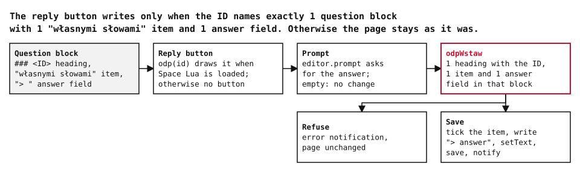

# SilverBullet libraries by Maciej Szulia

Two libraries for [SilverBullet](https://silverbullet.md): Decision Inbox adds a reply button to a page of questions, and Local AI connects the silverbullet-ai plug to a local Ollama server. Polish version: [README.pl.md](README.pl.md).

## Decision Inbox

[`Decision Inbox.md`](Decision%20Inbox.md) defines `odp(id)`, a button that writes an answer into the answer field of one question block. A question block looks like this:

```markdown
### Z-2026.11.15-01 Keep a weekly backup?

* [ ] `tak`: weekly backup
* [ ] własnymi słowami: ${type(odp) == "function" and odp("Z-2026.11.15-01") or ""}

> _(tu wpisz odpowiedź)_
```

A click on **Odpowiedz** opens a prompt. With the answer `daily, 30 days` the block becomes:

```markdown
* [x] własnymi słowami: ${type(odp) == "function" and odp("Z-2026.11.15-01") or ""}

> daily, 30 days
```

`odpWstaw`, the function behind the button, changes the page only when every condition holds:

1. Exactly 1 `###` heading carries the ID (a struck-through `~~ID~~` counts as the ID).
2. The block, from that heading to the next heading of any level, has exactly 1 `* [ ] własnymi słowami` item.
3. The block has exactly 1 answer line starting with `> `.

Otherwise the button shows an error and the page stays as it was.

The edit goes through `editor.getText` and `editor.setText`. Lua counts string positions in bytes and a Polish letter with a diacritic takes 2 bytes in UTF-8, so an offset-based edit would land off by the number of such letters before the field.

The guard `type(odp) == "function"` keeps the page plain Markdown while Space Lua has not loaded: there is no button and no Lua error, and the answer can still be typed into the `> ` line by hand.

The command **Owner: sprawdź skrypt odpowiedzi** runs the self-check on a sample page. Three `space-style` blocks colour the `#mid`, `#high` and `#critical` tags, draw the button with a visible keyboard focus, and hide the named-anchor marks in H3 headings.

The Lua code is a 1:1 copy of the SCRIPTS page and the styles are a 1:1 copy of the STYLES page in the author's own space, so the comments are in Polish.

## Local AI

[`Local AI.md`](Local%20AI.md) configures the [silverbullet-ai](https://github.com/justyns/silverbullet-ai) plug 0.9.3:

- provider `ollama` at `http://localhost:11434/v1`;
- `useProxy = false`: the browser calls Ollama directly, without the SilverBullet proxy;
- preferred models `qwen3.5:4b`, `qwen3.5:2b`, `qwen3.5:0.8b`, default `ollama:qwen3.5:4b`;
- a chat instruction to answer in Polish, in correct Polish and briefly.

The block carries `-- boot: true`, so SilverBullet applies it before indexing and the first render.

Requirements: the silverbullet-ai plug 0.9.3, installed separately (this page only configures it); Ollama on the computer that runs the browser, with the models from `preferredModels` pulled. After a change run `System: Reload`, then `AI: Connectivity Test`.

## Install

- **Library Manager**: run `Library: Add Repository` with `https://github.com/maciejszulia/silverbullet/blob/main/REPO.md`, then install a library from the list.
- **By hand**: copy the library page into your space under the same path, for example `Library/maciejszulia/Decision Inbox.md`, then run `System: Reload`.

The Library Manager has existed since SilverBullet 2.3.0 (upstream [CHANGELOG.md](../../CHANGELOG.md)). The commands `Library: Add Repository` and `Library: Install` exist in version 2.12.1; versions older than 2.12.1 are untested.

## How the reply button works



The diagram comes from [`tools/render_diagrams.py`](https://github.com/maciejszulia/claude-code-skills/blob/main/tools/render_diagrams.py) in the claude-code-skills repository.

## Test

The test runs the self-check cases against `odpWstaw` in plain Lua 5.4, plus 1 case the self-check lacks: a block with 2 answer fields stays unchanged. From the repository root:

```sh
lua5.4 "Library/maciejszulia/tests/test_decision_inbox.lua"
```

Expected: exit code 0 and the line `test_decision_inbox: OK`.

## Limits

- The block format is fixed and Polish: the item text `własnymi słowami` and the label `Odpowiedz` come from the author's own decision page.
- The prompt takes one line; the answer replaces the whole `> ` line.
- The button edits only the page open in the editor.
- The test runs `odpWstaw` in Lua 5.4, not in SilverBullet's Space Lua.
- With `useProxy = false` the browser sends requests straight to `localhost:11434`; a client on another device than the Ollama computer cannot reach Ollama.
- No embeddings model is configured, so the plug's semantic search does not work.

## License

MIT, copyright 2026 Maciej Szulia, for `Library/maciejszulia/` and `REPO.md`. The rest of the repository is upstream SilverBullet under its [LICENSE.md](../../LICENSE.md).

## Author

Maciej Szulia, [github.com/maciejszulia](https://github.com/maciejszulia).
