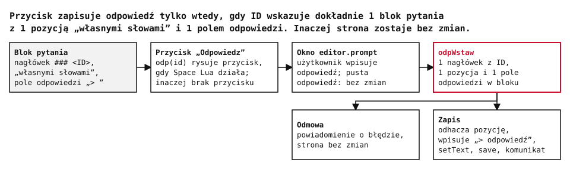

# Biblioteki SilverBulleta autorstwa Macieja Szuli

Repozytorium zawiera 2 biblioteki dla programu [SilverBullet](https://silverbullet.md). Biblioteka „Decision Inbox” dodaje przycisk odpowiedzi do strony z pytaniami. Biblioteka „Local AI” łączy plug `silverbullet-ai` z lokalnym serwerem Ollama. Wersja angielska: [README.md](README.md).

## Słownik

| Termin | Definicja | Słowa zakazane |
|---|---|---|
| blok pytania | Fragment strony, który obejmuje linie od nagłówka `### <ID>` do kolejnego nagłówka. | sekcja, wpis. |
| ID pytania | Ciąg znaków bez spacji, który stoi w nagłówku poziomu 3 bezpośrednio po znakach `### `. | numer, klucz. |
| pole odpowiedzi | Linia bloku pytania, która zaczyna się od znaków `> `. | cytat, ramka. |
| pozycja „własnymi słowami” | Pozycja listy zadań, która zaczyna się od tekstu `* [ ] własnymi słowami`. | checkbox, opcja. |

## Decision Inbox

Strona [`Decision Inbox.md`](Decision%20Inbox.md) definiuje funkcję `odp(id)`. Funkcja `odp(id)` rysuje przycisk „Odpowiedz”. Przycisk wpisuje odpowiedź do pola odpowiedzi w 1 bloku pytania. Przykład bloku pytania:

```markdown
### Z-2026.11.15-01 Czy robić kopię co tydzień?

* [ ] `tak`: kopia co tydzień
* [ ] własnymi słowami: ${type(odp) == "function" and odp("Z-2026.11.15-01") or ""}

> _(tu wpisz odpowiedź)_
```

Użytkownik klika przycisk „Odpowiedz” i wpisuje odpowiedź w oknie. Dla odpowiedzi `codziennie, 30 dni` blok pytania wygląda tak:

```markdown
* [x] własnymi słowami: ${type(odp) == "function" and odp("Z-2026.11.15-01") or ""}

> codziennie, 30 dni
```

Funkcja `odpWstaw` wykonuje zmianę strony. Funkcja `odpWstaw` zmienia stronę tylko wtedy, gdy strona spełnia każdy warunek:

1. Dokładnie 1 nagłówek `###` ma ID pytania. Funkcja traktuje przekreślone ID `~~ID~~` jak ID.
2. Blok pytania zawiera dokładnie 1 pozycję „własnymi słowami”.
3. Blok pytania zawiera dokładnie 1 pole odpowiedzi.

Jeżeli strona spełnia 3 warunki, to funkcja odhacza pozycję „własnymi słowami” i wpisuje odpowiedź do pola odpowiedzi. Jeżeli strona łamie co najmniej 1 warunek, to przycisk pokazuje komunikat o błędzie. Strona zostaje wtedy bez zmian.

Funkcja `odpWstaw` zmienia tekst przez funkcje `editor.getText` i `editor.setText`. Powód: Lua liczy pozycje w tekście w bajtach, a polska litera z ogonkiem zajmuje 2 bajty w UTF-8. Edycja według pozycji przesunęłaby zmianę o liczbę polskich liter przed polem odpowiedzi.

Wyrażenie `type(odp) == "function"` chroni stronę przed błędem Lua. Jeżeli klient SilverBulleta jeszcze nie załadował Space Lua, to strona pokazuje zwykły Markdown bez przycisku. Użytkownik wpisuje wtedy odpowiedź do pola odpowiedzi ręcznie.

Komenda „Owner: sprawdź skrypt odpowiedzi” sprawdza funkcję `odpWstaw` na stronie testowej. Strona biblioteki zawiera 3 bloki `space-style`. Pierwszy blok koloruje tagi `#mid`, `#high` i `#critical`. Drugi blok rysuje przycisk „Odpowiedz” z widoczną ramką fokusu klawiatury. Trzeci blok ukrywa znaczniki kotwic w nagłówkach H3.

Kod Lua to dokładna kopia strony SCRIPTS z przestrzeni autora. Style to dokładna kopia strony STYLES z przestrzeni autora. Komentarze w kodzie są po polsku, bo kod pochodzi ze stron SCRIPTS i STYLES.

## Local AI

Strona [`Local AI.md`](Local%20AI.md) konfiguruje plug [`silverbullet-ai`](https://github.com/justyns/silverbullet-ai) w wersji `0.9.3`. Konfiguracja ustawia każdą z tych wartości:

- Dostawca: `ollama` pod adresem `http://localhost:11434/v1`.
- Połączenie: przeglądarka łączy się z Ollamą bez proxy SilverBulleta (`useProxy = false`).
- Modele w kolejności preferencji: `qwen3.5:4b`, `qwen3.5:2b`, `qwen3.5:0.8b`.
- Model domyślny: `ollama:qwen3.5:4b`.
- Instrukcja dla czatu: „Odpowiadaj po polsku, poprawną polszczyzną i krótko.”

Blok konfiguracji ma komentarz `-- boot: true`. SilverBullet stosuje konfigurację przed indeksowaniem stron i przed pierwszym renderowaniem.

Spełnij każdy warunek przed użyciem biblioteki „Local AI”:

1. Zainstaluj plug `silverbullet-ai` w wersji `0.9.3`. Biblioteka „Local AI” tylko konfiguruje plug.
2. Uruchom Ollamę na komputerze, na którym działa przeglądarka.
3. Pobierz do Ollamy modele z listy `preferredModels`.

Po zmianie konfiguracji uruchom komendę `System: Reload`. Potem uruchom komendę `AI: Connectivity Test`.

## Instalacja

Wybierz dokładnie 1 sposób:

1. Library Manager: uruchom komendę `Library: Add Repository` z adresem `https://github.com/maciejszulia/silverbullet/blob/main/REPO.md`. Potem zainstaluj bibliotekę z listy.
2. Instalacja ręczna: skopiuj stronę biblioteki do przestrzeni pod tą samą ścieżką, na przykład `Library/maciejszulia/Decision Inbox.md`. Potem uruchom komendę `System: Reload`.

Library Manager istnieje od wersji `2.3.0` SilverBulleta (plik [CHANGELOG.md](../../CHANGELOG.md) upstreamu). Komendy `Library: Add Repository` i `Library: Install` istnieją w wersji `2.12.1`. Autor nie sprawdził wersji starszych niż `2.12.1`.

## Działanie przycisku „Odpowiedz”



Generator [`tools/render_diagrams.py`](https://github.com/maciejszulia/claude-code-skills/blob/main/tools/render_diagrams.py) z repozytorium claude-code-skills rysuje diagram.

## Test

Test uruchamia przypadki z komendy samosprawdzenia na funkcji `odpWstaw` w interpreterze `lua5.4`. Test sprawdza także 1 przypadek spoza samosprawdzenia: funkcja `odpWstaw` zwraca `nil` dla bloku pytania z 2 polami odpowiedzi. Uruchom test z katalogu głównego repozytorium:

```sh
lua5.4 "Library/maciejszulia/tests/test_decision_inbox.lua"
```

Wynik: kod wyjścia 0 oraz linia `test_decision_inbox: OK`.

## Granice

- Format bloku pytania jest stały. Tekst „własnymi słowami” i etykieta „Odpowiedz” pochodzą ze strony decyzji autora.
- Okno odpowiedzi przyjmuje 1 linię tekstu. Odpowiedź zastępuje całe pole odpowiedzi.
- Przycisk zmienia tylko stronę otwartą w edytorze.
- Test uruchamia funkcję `odpWstaw` w interpreterze `lua5.4`. Test pomija Space Lua SilverBulleta.
- Ustawienie `useProxy = false` kieruje zapytania przeglądarki wprost do adresu `localhost:11434`. Klient na innym urządzeniu niż komputer z Ollamą nie dosięga Ollamy.
- Konfiguracja pomija model embeddingów. Wyszukiwanie semantyczne pluga `silverbullet-ai` nie działa.

## Licencja

Licencja MIT, prawa autorskie 2026 Maciej Szulia. Licencja obejmuje katalog `Library/maciejszulia/` oraz plik `REPO.md`. Reszta repozytorium to SilverBullet z upstreamu na licencji z pliku [LICENSE.md](../../LICENSE.md).

## Autor

Maciej Szulia, [github.com/maciejszulia](https://github.com/maciejszulia).
